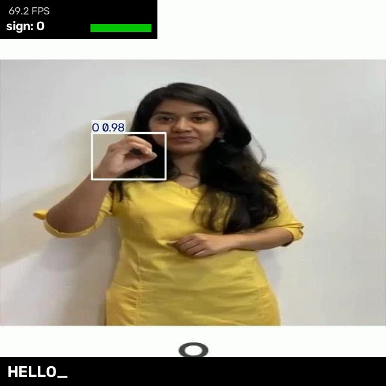
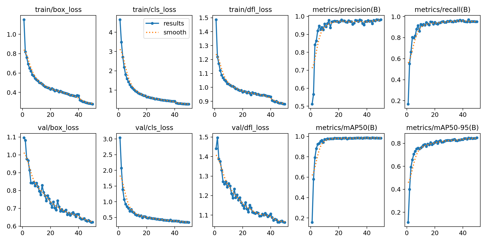
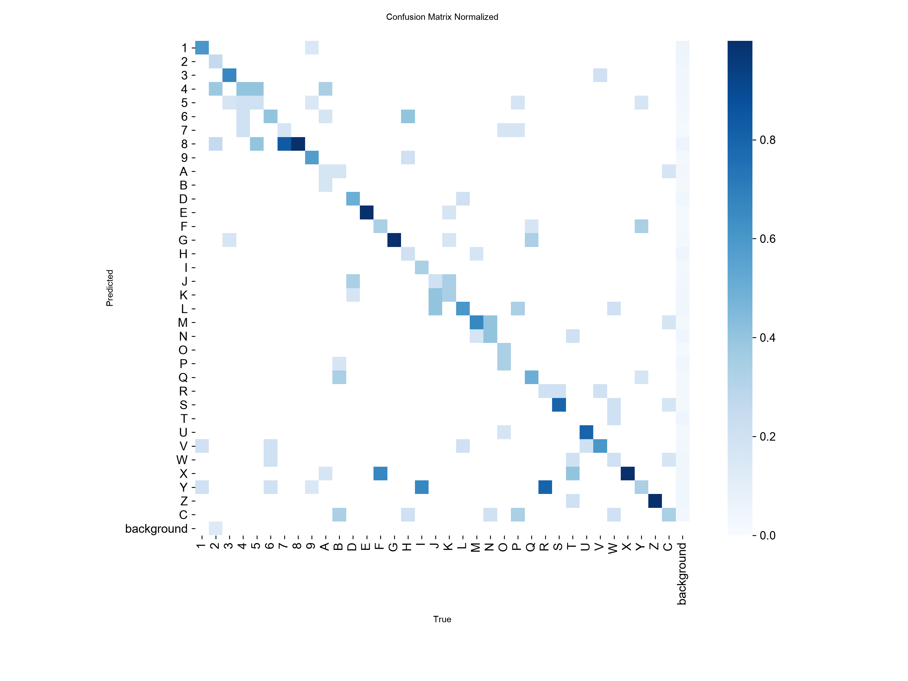

# Indian Sign Language Recognition

Real-time recognition of Indian Sign Language (ISL) signs with fine-tuned YOLOv11 detection models, with a webcam demo that turns held signs into text.

<p align="center"></p>

Two models are included, both YOLOv11n (5 MB, ~70 FPS on an Apple M3):

| Model | Signs | Test mAP50 | Test mAP50-95 | Test top-1 accuracy |
|---|---|---|---|---|
| [`isl-alphabet-yolo11n.pt`](weights/isl-alphabet-yolo11n.pt) | 35 — digits 1–9, letters A–Z | 0.984 | 0.831 | 96.9% (92.3% on independent photos¹) |
| [`isl-phrases-yolo11n.pt`](weights/isl-phrases-yolo11n.pt) | 114 — digits, letters and everyday words (*help*, *where*, *school*, *namastey*, …) | 0.952 | 0.703 | 93.2% |

*Top-1 accuracy* = share of test images where the most confident detection is the correct sign, which is what the live demo relies on. ¹ See [How good is it really?](#how-good-is-it-really)

## Why ISL

Most published sign-language recognition work targets ASL. Indian Sign Language has a different alphabet, is largely two-handed, and has far less annotated public data — which makes it both a harder problem and a more useful one to work on.

## Quick start

```bash
git clone https://github.com/dulfazl/yolov11-isl.git
cd yolov11-isl
python -m venv .venv && source .venv/bin/activate
pip install -r requirements.txt

python infer.py                       # alphabet model on your webcam
python infer.py --weights phrases     # 114-class words model
```

Hold a sign steady for a moment (8 frames, about a quarter of a second) and it is typed into the transcript bar. Lower your hand (or change sign) to type the same sign twice. Keys: **Space** inserts a space, **Backspace** deletes, **Enter** clears, **q** quits.

On macOS, grant your terminal camera access the first time (System Settings → Privacy & Security → Camera).

## Usage

All scripts accept a task name (`alphabet` or `phrases`) wherever they take weights or data, and pick the fastest device automatically (CUDA → Apple MPS → CPU).

**Inference** — webcam, video file, image or folder:

```bash
python infer.py --source 1                              # second camera
python infer.py --source clip.mp4 --save out.mp4 --no-show
python infer.py --weights phrases --source photos/      # annotated copies in runs/predict/
python infer.py --mirror --hold 12 --conf 0.6           # selfie view, slower typing, stricter
```

**Get the data** — both datasets are on Roboflow Universe (CC BY 4.0). With a free [Roboflow API key](https://app.roboflow.com/settings/api):

```bash
export ROBOFLOW_API_KEY=...
python download_data.py all        # -> datasets/isl-alphabet, datasets/isl-phrases
```

Or download the *YOLOv11* zip from the dataset pages below and unzip it into those folders.

**Evaluate** — detection metrics plus per-class top-1 accuracy:

```bash
python evaluate.py --weights alphabet --split test
python evaluate.py --weights phrases --split val
python analysis/caption_shortcut.py                # the caption robustness check below
```

Writes `metrics.json`, `per_class.csv` and plots to `results/<task>/<split>/`.

**Train** — defaults reproduce the published weights:

```bash
python train.py --data alphabet                    # yolo11n, 50 epochs, 640 px, batch 16
python train.py --data phrases --model yolo11s.pt --epochs 100
python train.py --data alphabet --publish          # also copy best.pt into weights/
```

The published models were trained on a Colab T4 (~1 h for the alphabet model). On an Apple M3 an alphabet epoch takes about 3 minutes.

**Export** for deployment:

```bash
python export.py --weights alphabet --format onnx      # ONNX Runtime / OpenCV DNN
python export.py --weights alphabet --format coreml    # iOS / macOS
python export.py --weights phrases --format tflite     # Android / edge
```

## Results

Evaluated locally on the held-out **test** splits, which were never used during training or model selection. Full per-class tables are in [`results/`](results).

| | Alphabet test | Alphabet val | Phrases test | Phrases val |
|---|---|---|---|---|
| Images in split | 195 | 425 | 414 | 424 |
| Classes present | 35 / 35 | 35 / 35 | 102 / 114 | 96 / 114 |
| Precision | 0.969 | 0.982 | 0.835 | 0.911 |
| Recall | 0.948 | 0.952 | 0.888 | 0.901 |
| mAP50 | 0.984 | 0.983 | 0.952 | 0.953 |
| mAP50-95 | 0.831 | 0.839 | 0.703 | 0.677 |
| Top-1 accuracy | 96.9% | 96.7% | 93.2% | 92.4% |

**Weakest signs on test.** Alphabet: E (2/3), 4, N, V (4/5 each), 3 and D (5/6). Phrases: *5* and *help* (0/2), plus several words with only 2–3 test images. *C* is the most common phrases class and scores 40/50.

<table>
<tr>
<td></td>
<td></td>
</tr>
<tr>
<td align="center">Alphabet training curves (50 epochs)</td>
<td align="center">Alphabet confusion matrix, test split</td>
</tr>
</table>

### How good is it really?

The headline numbers come from small test sets drawn from the same sources as the training data, so they are upper bounds. Two checks make them more honest:

- **Video frames vs. photos.** 117 of the 195 alphabet test images are frames from a few teaching videos with the same signers, and the model gets all of them right. Neighbouring frames of the same clip almost certainly sit in the training set too. On the 78 **independent photos** top-1 accuracy is **92.3%** (91.9% on val). That is the better estimate for a new person in front of a webcam.
- **Caption shortcut.** Those video frames print the answer ("X", "7", …) in a white band under the signer. To check whether the model reads the caption instead of the hand, [`analysis/caption_shortcut.py`](analysis/caption_shortcut.py) paints the band over: accuracy stays at 100%. Showing the model *only* the caption band gives 0%. It is reading hands, not text.

| Alphabet, top-1 accuracy | Original | Caption hidden | Caption only |
|---|---|---|---|
| Video frames, test (117) | 100% | 100% | 0% |
| Photos, test (78) | 92.3% | 92.3% | 6.4% |

## How it works

1. **Data** — two public Roboflow datasets of ISL signs with a bounding box around the signing hand(s), resized to 640×640. Roboflow added offline augmentation (exposure changes for the alphabet; rotation, shear, brightness and noise for phrases) on top of YOLO's own training augmentation.
2. **Model** — YOLOv11n pretrained on COCO, fine-tuned for 50 epochs at 640 px with Ultralytics defaults. Detection rather than whole-image classification means the model localises the hands, so it copes with signers anywhere in the frame and with cluttered backgrounds.
3. **Live inference** — each webcam frame goes through the detector, and the most confident detection is the current sign. `SignStabilizer` in [`infer.py`](infer.py) commits a sign only after it has been the top detection for `--hold` consecutive frames (default 8). This filters single-frame flicker, and requiring a gap or a different sign before repeating stops one held sign being typed many times.

## Repository layout

```
configs/            data configs (class lists, dataset paths)
weights/            trained models: isl-alphabet-yolo11n.pt, isl-phrases-yolo11n.pt
results/<task>/     train/  — original Colab training logs and curves
                    test/, val/ — local evaluation: metrics.json, per_class.csv, plots
analysis/           caption_shortcut.py robustness check
infer.py            webcam / video / image inference with live transcript
evaluate.py         mAP + per-class top-1 accuracy on any split
train.py            reproducible fine-tuning
export.py           ONNX / CoreML / TFLite / … export
download_data.py    fetch datasets from Roboflow
common.py           shared paths and device selection
```

## Limitations and next steps

- **Few signers.** Both datasets come from a handful of people, mostly against plain or green-screen backgrounds. Expect lower accuracy for new signers, skin tones, lighting and backgrounds than the tables suggest. More diverse data is the biggest lever.
- **Static signs only.** Each frame is classified on its own, so signs defined by motion (many words and some letters) are recognised only by their most distinctive pose. A temporal model over hand keypoints or short clips would handle full ISL sentences.
- **Small test sets.** 3–8 images per alphabet class and 1–50 per phrases class, so per-class numbers are noisy. 12 phrases classes have no test images at all.
- **Larger backbones.** Only YOLOv11n was trained. `yolo11s`/`yolo11m` should help mAP50-95, especially for the 114-class model, at some cost in FPS.

## Datasets and credits

- **Alphabet** — [Indian Sign Language Detection v1](https://universe.roboflow.com/project-ze4h3/indian-sign-language-detection-nv2xc/dataset/1), Roboflow Universe, CC BY 4.0. In the export, class 34 is a lowercase `c`; it is relabelled `C` here (same index).
- **Phrases** — [ROHIT_ISL(115) v4](https://universe.roboflow.com/rohit-sjsqg/rohit_isl-115/dataset/4), Roboflow Universe, CC BY 4.0.
- Models trained with [Ultralytics YOLO11](https://docs.ultralytics.com/models/yolo11/) (AGPL-3.0).

## Roadmap

- [x] Dataset collection and annotation
- [x] Baseline training run and evaluation
- [x] Real-time webcam inference
- [x] Published weights and reproducible training script

---

Built by [Muhammed Dulfazal](https://github.com/dulfazl) — MSc AI & ML, VIT Vellore.
